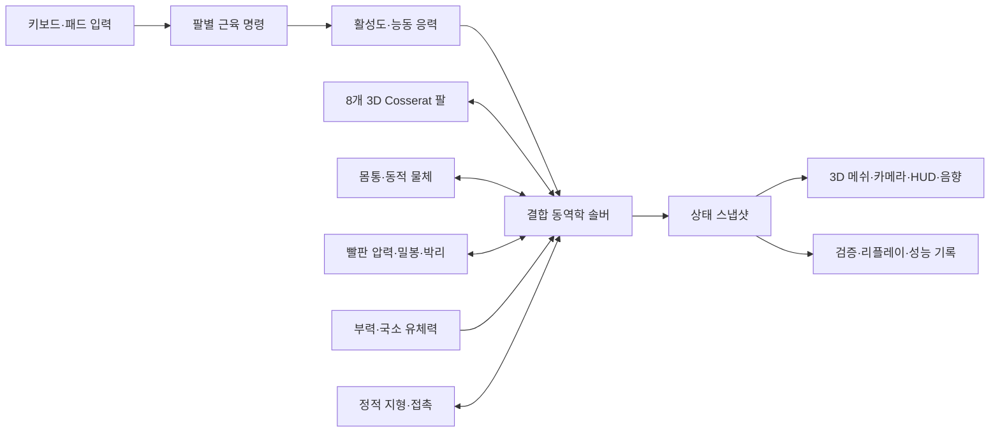

# OCTOPUS — 게임 기획 및 구현 명세

> 2026-11-14 추가 계약: 본문의 강체 몸통·렌더 전용 맨틀·연성체 후속 과제 표현은 비교 기준에 한정한다. 최종 구현은 VOLUMETRIC_SOFTBODY_ADDENDUM.md의 체적 몸통·팔 단면과 V16–V21을 필수로 한다.
버전 1.0 · 2026-11-14 · 상태: 구현 기준 초안

## 0. 결정과 해석 규칙

**제품:** PC용 완전 3D, 3인칭, 싱글 플레이 물리 샌드박스 겸 짧은 퍼즐 게임. 한 마리의 문어를 조작해 8개 팔로 지형에 붙고, 몸통을 이동시키고, 물체를 집어 목표 구역에 놓는다. 이동과 조작은 같은 물리 시스템에서 발생한다. 물리 시스템이 성립하면 수중 탐험 레벨을 확장한다.

**기본 엔진:** Godot **4.7.2 stable**, Forward+ 렌더러, C++20 독립 물리 라이브러리, Godot GDExtension, CMake, Eigen, Blender, Python 기반 오프라인 분석. Godot 4.7.2의 공식 릴리스 존재는 2026-11-14에 확인했다. 실제 착수 시 배포물과 `godot-cpp` 대응 태그·해시를 다시 확인해 잠근다. Jolt/Godot 내장 물리는 플레이어와 동적 물체의 최종 동역학에 사용하지 않는다. Godot은 렌더링, UI, 오디오, 에디터, 입력, 장면 제작에 쓴다.

| 선택지 | 이 프로젝트에 유리한 점 | 비용·제약 | 판정 |
|---|---|---|---|
| Godot + 독립 C++ 솔버 | 빠른 반복, 가벼운 배포, 엔진과 솔버 분리, GDExtension 공식 경로 | 고급 수중 렌더링·프로파일링 자체 작업 | **기본** |
| Unreal Engine + C++ | 성숙한 고품질 3D 렌더링·도구 | 빌드·반복 비용, 커스텀 통합의 복잡도, 라이선스 검토 | 렌더링 목표가 우선순위를 바꿀 때 재평가 |
| Unity + 네이티브 플러그인 | 큰 에셋 생태계 | 네이티브 물리 세계와 엔진 물리 세계를 이중 관리 | 기본 선택 아님 |

엔진 전환 게이트: P3 종료 시 대표 수중 장면에서 60 FPS와 필수 시각 품질을 얻지 못하고, 프로파일링 결과 Godot 렌더러가 병목이며 합리적 최적화로 해결되지 않을 때만 검토한다. 물리 코어 API와 데이터 포맷은 엔진 독립으로 유지한다.

**표기:** `[근거]`는 인용된 일반 원리, `[모델]`은 이 프로젝트가 제안한 방정식, `[초기값]`은 튜닝 시작점, `[목표]`는 수용 기준이다. 실제 문어 종, 크기, 물성, 빨판 수, 근육 최대 응력은 현재 확정되지 않았다. 수치 재현을 주장하려면 별도 실측 비교가 필요하다.



## 1. 게임 규칙과 플레이 감각

### 1.1 핵심 루프

관찰 → 팔 선택·방향 지정 → 근육 활성화·빨판 접촉 → 하중 전달과 몸통 이동/물체 이동 → 부착 해제·재배치. 첫 플레이 가능한 레벨은 수중 연구 탱크다. 바닥, 45° 경사, 수직 벽, 천장, 좁은 통로, 이동 가능한 상자, 목표 발판이 한 공간에 있다. 성공 조건은 문어가 지정한 지점으로 이동한 뒤 상자를 목표 발판에 3초 유지하는 것이다. 리셋과 자유 실험 모드가 있다.

### 1.2 플레이어에게 보이는 인과관계

팔을 뻗으면 축방향 신장에 따라 굵기가 변한다. 벽에 닿은 빨판은 접촉→밀봉→부착의 상태를 순서대로 보인다. 당기면 팔과 몸통이 함께 반응하고, 표면 하중이 한계에 이르면 가장 취약한 테두리부터 빨판이 벗겨진다. 물체가 가벼우면 물체가 끌려오고, 무거우면 몸통이 움직인다. 같은 입력·같은 초기 상태·같은 시드에서 같은 결과를 낸다.

### 1.3 조작 체계

기본은 키보드·마우스, 게임패드 동등 기능 제공. 팔 8개는 몸통을 위에서 보았을 때 전방부터 시계 방향으로 `A0…A7`, 색과 숫자를 함께 표시한다. `1…8`은 팔 선택, `Tab`은 다음 팔, `Shift+Tab`은 이전 팔. 마우스 커서는 카메라 공간 목표점의 레이캐스트, 휠은 목표 거리 조절. 왼쪽 버튼을 누르는 동안 선택 팔의 굽힘·신장 목표를 향한 **근육 명령**을 증가시키고 놓으면 활성도가 감쇠한다. 오른쪽 버튼은 빨판 활성화/해제 명령. `Q/E`는 축 비틀림, `W/S`는 길이 조절 의도, `A/D`는 선택 팔의 좌우 굽힘 의도. `Space`는 몸통 제트 추진 보조를 짧게 활성화한다. 이 보조는 별도 물리 외력이며 자유 위치 이동이 아니다. `R`은 체크포인트 리셋, `F1`은 힘·접촉 디버그 오버레이.

게임패드는 좌 스틱으로 카메라 공간 목표 방향, 우 스틱으로 카메라, LT/RT로 팔 선택 순환, A로 빨판, X로 신장 의도, B로 수축 의도, 범퍼 조합으로 비틀림. 모든 동작은 입력 액션 맵에만 바인딩한다. 재설정 UI와 색각 보조 숫자 표시가 필요하다. 팔 하나를 세밀히 조종하는 동안 나머지는 수동 조직역학과 낮은 강도의 자세 안정화 제어를 따른다. 8개 팔의 개별 제어 가능성은 유지하되, 동시 조작의 인지 부담을 줄이기 위해 2개 팔 명령 저장 슬롯을 제공한다.

제어 계층은 `InputIntent`(의도) → `MuscleController`(각 구간 근육 활성도 명령) → 물리 솔버다. 목표점을 직접 따라가는 운동학적 위치 강제는 금지한다. 목표 추종 PID/최적화는 근육 활성도 `[0,1]`만 출력한다. 보조 제어를 끄고 순수 팔별 근육 명령으로 플레이할 수 있는 전문가 모드를 제공한다.

### 1.4 화면·카메라·그래픽·사운드

3인칭 추적 카메라, 몸통 기준 2–8 m 줌, 벽 근처 카메라 충돌 회피, 목표 지점과 선택 팔 루트·끝 강조. 60 Hz 렌더 보간; 물리 상태는 120 Hz 고정 간격. 팔 메시의 단면 반경은 시뮬레이션의 국소 면적에서 나오고, 별도 애니메이션으로 물리를 위조하지 않는다. 메시 스키닝은 rod 노드의 위치와 단면 회전 프레임을 사용한다. 빨판 128개까지 근접 세부 메시와 원거리 인스턴스를 LOD로 전환한다. 피부는 젖은 표면의 거칠기·색 변화와 얕은 반투명 느낌을 표현하되, GPU 효과가 물리 접촉점을 변경하지 않는다. 접촉 순간 짧은 점착음, 하중 증가 시 장력 음, 박리 시 연속 팝 소리, 힘이 과할 때 진동을 사용한다. 사운드는 게임 상태를 전달하지만 정확한 생물 소리를 재현한다는 주장은 하지 않는다.

HUD: 선택 팔, 흡착한 빨판 수, 현재 하중/한계, 몸통 이동 속도, 목표, 재시도. 디버그 HUD: 단계 시간, Newton 잔차, 반복 횟수, 접촉 수, 에너지, 부피 오차, 빨판 압력, 모멘텀 잔차. 일반 플레이에서는 디버그 수치를 숨긴다.

## 2. 좌표·단위·물리 상태

SI 단위(m, kg, s, N, Pa), 오른손 좌표계, `+Y` 위, 물속 중력 `g=(0,-9.81,0) m/s²`. 모든 힘은 월드 좌표, 재료 변형률은 국소 단면 좌표. 회전은 단위 quaternion(저장)과 SO(3) exponential map(증분). `s∈[0,L0]`는 변형 전 호 길이. 각 팔은 `[초기값]` 길이 1.0 m, 근위 반경 0.075 m, 원위 반경 0.012 m, 24개 요소·25개 중심선 노드. 몸통은 하나의 6자유도 강체로 시작하고, 외형 맨틀 변형은 렌더 계층이다. 몸통 연성 변형은 별도 후속 연구 항목이며 현재 핵심 수용 범위가 아니다.

각 요소 `i`에 중심 위치 `r_i`, 속도 `v_i`, 단면 방향 `R_i`, 각속도 `ω_i`, 기준 길이 `Δs_i`, 기준 단면 `A0_i`, 변형 단면 `A_i`, 관성 텐서 `J_i`를 둔다. 일관된 질량 분배는 요소/노드 조립 시 한 번 정하고 테스트로 확인한다. 팔 루트는 몸통의 로컬 앵커 `X_root,a`에 강체-rod 접합 제약으로 연결한다. 팔 끝은 자유 경계다. 각 노드는 몸통·다른 팔·자기 팔·환경과 충돌 가능하다. 자기충돌에서는 인접 요소 2개를 제외한다.

### 2.1 3D Cosserat rod [근거: E1, 모델]

연속체 상태 `r(s,t)∈R³`, `R(s,t)∈SO(3)`. 전단·신장 `ν=Rᵀ ∂r/∂s`, 굽힘·비틀림 `κ=vee(Rᵀ ∂R/∂s)`. 기준 `ν0=(0,0,1)`; 테이퍼로 변하는 강성과 단면을 허용한다. 공간 좌표 내부 힘 `n=R[Kν(ν−ν0)+Dν ν̇+n_act]`, 내부 모멘트 `m=R[Kκ(κ−κ0)+Dκ κ̇+m_act]`. `Kν=diag(GA,GA,EA)`, `Kκ=diag(EI1,EI2,GJ)`는 **초기 선형·등방 근사**다. 축 굽힘 및 비틀림의 큰 변형에서는 국소 비선형 구성법칙을 교체 가능하도록 인터페이스화한다.

보존식: `ρA r̈=∂n/∂s+f_ext`; `∂(Jω)/∂t=∂m/∂s+(∂r/∂s)×n+ℓ_ext`. `J`와 `ω`의 좌표계 변환을 구현 전체에서 일치시킨다. 이산화는 각 요소의 양끝 위치와 단면 회전을 써서 `ν_i=R_midᵀ(r_{i+1}−r_i)/Δs_i`, `κ_i=Log(R_iᵀR_{i+1})/Δs_i`; `R_mid`는 SO(3) 보간. `Log`의 π 근처 분기와 quaternion 부호 연속성을 처리한다. 굽힘, 비틀림, 전단, 축력 모두 반작용으로 조립한다. 세부 조립과 접선행렬은 수치 차분 검증 후 자동 미분 또는 해석 미분으로 최적화한다.

### 2.2 Muscular Hydrostat [근거: E2, 모델]

3D 근육 조직의 거의 비압축성은 `det F≈1`. 1D rod 근사는 `A_i λ_i≈A0_i`, `λ_i=ν_i,z`를 사용한다. 원형 단면 초기 근사는 `radius_i=radius0_i/sqrt(max(λ_i,λ_min))`. 이는 굽힘 중 비원형 단면·국소 압축·근육층 미세구조를 재현하지 않는다. 부피 오차 `eV=|Σ A_i λ_i Δs_i−Σ A0_i Δs_i|/V0`를 관찰한다. `λ`를 제한하거나 면적 보정으로 음수 단면을 방지한다.

근육군은 요소마다 종주근 4사분면 `L0…L3`, 횡근 `T`, 좌·우 사근 `O+`,`O−`의 7채널로 시작한다. 8×24×7=1,344 활성 변수. 채널 `j`의 활성 `a_j`는 `τ_on/off ȧ_j=u_j−a_j`, `u_j∈[0,1]`로 갱신한다. 길이·속도 의존 수축력 후보는 `σ_act,j=a_j σmax,j f_l(λ_j) f_v(λ̇_j)`이며 `f_l=exp(-((λ_j−λopt)/w)^2)`, `f_v=clamp(1−c_v λ̇_j, fmin,fmax)`를 **게임 모델**로 둔다. 팔 단면의 섬유 위치·방향 `e_j(x)`에 대해 `n_act=∫_A σ_act e_j,z e_j dA`, `m_act=∫_A x×(σ_act e_j) dA`를 수치 적분하거나 사전 계산 계수표로 조립한다. 횡근의 압박은 부피 제약을 통해 축 신장 의도로, 비대칭 종주근은 굽힘 모멘트로, 사근은 비틀림 모멘트로 전달한다. 근육은 밀 수 없는 인장 섬유이므로 계산된 수축력은 음수가 되지 않는다.

### 2.3 빨판 압력·밀봉·접촉·박리 [근거: E3, 모델]

각 팔 요소의 복측에 `[초기값]` 16개 시뮬레이션 빨판을 비균일하게 배치한다(총 128개). 더 많은 시각적 빨판은 인스턴싱하되 역학 빨판과 1:1 대응하지 않는다는 점을 게임 내 인과관계가 요구하는 거리에서 숨기지 않는다. 빨판은 `FREE → TOUCH → SEALING → ATTACHED → PEELING → FREE`, 실패 시 `LEAKING → FREE` 상태기계를 가진다. 전이는 시간 히스테리시스, 접촉 법선 정렬, 표면 물성, 테두리 접촉 비율로 결정한다. 부착은 순간적인 무한 강성 고정이 아니다.

외압 `p_ext=p_surface+ρ_w g h`; 내부 압력 `p_in`; 압력차 `Δp=clamp(p_ext−p_in,0,Δp_max)`. 유효 면적 `A_eff=πr_cup² φ_seal(1−d_peel)`. 흡착 인장 한계 `F_s=Δp A_eff`. 압력 동역학의 **집중정수 후보식**은 `C_eff ṗ_in=Q_leak−V̇_act`, `C_eff=V/K_w+C_wall`(m³/Pa), `Q_leak=G_seal Δp`(m³/s). 부호·단위·수치 범위를 단위 테스트한다. 수압이 높거나 외압이 변할 때 압력 상태를 재평형한다. `p_in≥p_vapor`와 `p_in≤p_ext`로 제한하되 공동현상 및 실제 문어 생리를 정확히 묘사한다고 주장하지 않는다. `G_seal=G0+Ggap Σ_k(max(g_k,0)/g_ref)^3 Δθ/2π`는 12개 테두리 샘플의 틈에 따른 **모델 가정**이다. `φ_seal`은 접촉한 테두리 샘플 비율에 연속 보간과 히스테리시스를 적용한다.

비관통 접촉 `g_n≥0, λ_n≥0, g_n λ_n=0`. 빨판의 접착 인장 `λ_adh∈[-F_s,0]`는 별도 제약이다. 접선 마찰 `||λ_t||≤μ(λ_n+max(0,-λ_adh))`은 유효 초기 모델이다. 표면 재질별 `μ`, 거칠기, 누출 계수, 밀봉 가능 여부를 명시한다. 박리는 테두리 샘플별 열림 정도 `d_k∈[0,1]`를 두고 `ḋ_k=rate·max(G_release,k/G_c−1,0)`; `G_release≈(Δλ_k²)/(2k_rim A_k)`를 제안한다. `G_c`는 유효 계면 파괴 에너지로 실측 미확정이다. 이 근사는 단위·에너지 일관성 검증을 거쳐야 하며, 해당 검증 전에는 하중/강도 비율 기반의 보수적 테두리 손상 법칙을 사용한다. 손상은 인접 샘플로 확산하고 밀봉 면적과 압력 저하를 되먹임한다. 수중 유리·거친 바위·다공성 표면의 부착 차이를 보여야 한다.

### 2.4 유체력 [근거: E4, 모델]

물은 1차 버전에서 정지 또는 주어진 속도장 `u(x,t)`의 비압축성 배경 유체다. Navier–Stokes 전체 양방향 유동 계산은 범위 밖이며, **유체-구조 상호작용은 유체가 팔·몸통에 가하는 국소 힘과 물체 변위에 따른 부력·항력을 뜻한다.** 팔의 접선 `t`, 상대속도 `w=v−u`, `w∥=(w·t)t`, `w⊥=w−w∥`에 대해 길이당 항력 `f_d=−½ρ_w d[C⊥||w⊥||w⊥+C∥||w∥||w∥]`. `d`는 직경이며 이 식의 계수는 해당 투영 면적 정의에 맞춰 튜닝한다. 부가질량 후보 `f_a=−m_a,⊥(a−D_tu)_⊥−m_a,∥(a−D_tu)_∥`은 안정성·관성 검증 뒤 켠다. 팔과 몸통 부력은 `F_b=ρ_w g_abs V e_y`; 무게는 `F_g=−m g_abs e_y`. 몸통 항력은 방향별 투영면적 기반. 수면, 제트 추진의 반작용, 물결 시각 효과는 분리한다. 제트 추진은 연료성 체력/쿨다운과 `F_jet`을 몸통에 적용하며 운동량 보존 검증 범위에서는 외부 질량 유출로 기록한다.

### 2.5 몸통-팔-환경 양방향 결합 [모델]

**모든 움직이는 게임 물체**(몸통, 8개 팔, 상자, 문, 발판)는 한 C++ 동역학 세계에 속한다. Godot `RigidBody3D`와 힘을 왕복시키는 약결합은 최종 경로가 아니다. 정적 지형은 충돌 BVH/간단 프리미티브로 가져오고, 동적 물체는 질량·관성·충돌 형상·속도를 물리 코어가 보유한다. Godot 노드는 결과 pose만 받는다. 접촉 캐시는 양쪽 물체 ID, 로컬 앵커, 법선, 마찰 상태를 갖는다. 빨판이 상자에 붙으면 접착 제약 Jacobian이 팔 노드와 상자 강체의 자유도 양쪽에 동시에 작용한다. 루트 제약은 팔과 몸통에 동일·반대 힘/모멘트를 전달한다.

일반화 상태 `q=(x_body,R_body,{r_ai,R_ai}, {x_obj,R_obj})`, 속도 `v`. 한 시간 단계에서 `M(vⁿ⁺¹−vⁿ)/h=f_internal(qⁿ⁺¹,vⁿ⁺¹)+f_external+Jᵀλ`, `qⁿ⁺¹=Integrate_SE3(qⁿ,hvⁿ⁺¹)`. 루트 접합, 비관통, 마찰, 빨판 접착의 보완·제한 조건을 같은 비선형 solve에 넣는다. P2의 첫 구현은 backward Euler + line search Newton + augmented Lagrangian/active set, 따뜻한 시작. 접촉 충격이 큰 경우에는 속도 수준 충돌 impulse를 앞단에 적용한 뒤 위치 오차 보정한다. 수렴 실패 시 하위 시간 단계 2분할→4분할; 그래도 실패하면 해당 프레임을 안전하게 중단하고 재현 스냅샷을 기록한다. 힘을 임의로 버리거나 위치를 텔레포트하는 복구는 금지한다.

## 3. 자료구조와 인터페이스

핵심 코어는 Godot 헤더를 포함하지 않는다. `double`로 시뮬레이션하고 렌더 버퍼만 `float`로 변환한다. SoA 연속 배열과 안정 ID를 사용한다. 다음은 계약 수준의 C++ 의사코드다.

```cpp
using BodyId = uint32_t; using ArmId = uint8_t; using CupId = uint16_t;
struct RodState { Vec3d r[8][25], v[8][25]; Quatd R[8][24]; Vec3d omega[8][24]; };
struct MuscleState { float activation[8][24][7]; float command[8][24][7]; };
struct CupState { CupId id; ArmId arm; uint8_t element; CupPhase phase;
  double p_in, V, seal_fraction, peel[12]; BodyId target; Vec3d local_anchor; };
struct RigidState { BodyId id; Pose pose; SpatialVelocity velocity;
  double mass; Mat3d inertia_body; ShapeId shape; MaterialId material; };
struct Contact { StablePair key; Vec3d point_a, point_b, normal;
  double gap, lambda_n; Vec2d lambda_t; uint32_t feature_id; };
struct InputIntent { ArmId selected; Vec3d target_world; double reach, twist;
  bool suction; double jet; uint64_t tick; };
struct StepStats { double residual, volume_error, momentum_error, cpu_ms;
  uint32_t newton_iters, contacts, active_cups, substeps; bool converged; };
struct Snapshot { uint64_t tick, seed; RodState rods; MuscleState muscles;
  vector<CupState> cups; vector<RigidState> rigids; };
class IPhysicsWorld { public: virtual void enqueue(InputIntent)=0;
  virtual StepStats step(double fixed_dt)=0; virtual Snapshot snapshot() const=0;
  virtual void restore(const Snapshot&)=0; };
```

`world.step`의 단계: (1) tick 순서 입력 취합·근육 명령 갱신 (2) 압력·유체 외력 예측 (3) 광역 충돌 후보(AABB tree/BVH), 세부 접촉(구·캡슐·볼록체·삼각형) (4) 빨판 상태/테두리 샘플 갱신 (5) 보존력·감쇠·근육·제약 잔차와 Jacobian 조립 (6) 결합 implicit solve (7) 충돌·압력·상태 보정 (8) 불변량·수렴 검사 (9) 불변 스냅샷 생성. 순서는 결정적이고 ID 정렬을 유지한다. `enqueue`는 tick 경계에서만 반영한다. 렌더는 직전 두 완료 스냅샷을 보간하며 solver 배열을 직접 읽지 않는다.

모듈: `octo_math`(SO3·선형대수), `octo_rod`(운동학·탄성), `octo_muscle`, `octo_cup`, `octo_contact`, `octo_fluid`, `octo_rigid`, `octo_solver`, `octo_scene`, `octo_replay`, `octo_metrics`; `godot_bridge`(GDExtension), `game`(GDScript 입력·UI·레벨), `tools`(에셋·분석). 모듈은 서로의 내부 배열에 접근하지 않고 World의 핸들·조립 인터페이스를 쓴다. 공용 씬 포맷은 버전이 있는 JSON 또는 바이너리+JSON 메타데이터로 정하고 단위·좌표·재질 정의를 함께 저장한다. 저장 파일의 버전 불일치는 명시적 마이그레이션 또는 오류다.

GDExtension `OctopusWorld3D`: `load_scene(path)`, `queue_intent(Dictionary)`, `advance_fixed_tick()`, `get_render_snapshot()`, `get_stats()`, `save_replay(path)`. Godot 메인 스레드에서 scene node 상태를 수집해 tick 명령으로 넘긴다. 솔버 스레드와 렌더 스레드 사이에는 이중 버퍼를 둔다. Godot 물리 tick과 커스텀 tick의 상이한 시간 간격에서 누락·중복 tick이 생기지 않도록 누적기와 최대 catch-up 4회를 사용한다. 4회를 넘으면 플레이 시간 진행을 늦추고 로그를 남기며 가변 시간 간격으로 물리 단계를 늘리지 않는다.

### 3.1 결합 단계의 구현 의사코드

```text
step(h, commands):
  assert(h == FIXED_DT && finite(state))
  apply_commands_at_tick_boundary(commands)
  integrate_activation_implicitly(h)             # [0,1] 제한
  candidates = broadphase(dynamic_AABB, static_BVH)
  contacts = narrowphase(candidates, stable_feature_ids)
  cups = update_cup_seal_pressure_and_peel_predictor(cups, contacts, h)
  x = warm_start(previous_solution, state)
  for split in [1, 2, 4]:
    for substep in 1..split:
      for iter in 1..MAX_NEWTON:
        residual, sparse_J = assemble_all_bodies_rods_cups(x)
        active_set = update_contact_adhesion_friction(active_set, x)
        dx = sparse_solve(sparse_J, -residual)
        x = line_search_with_positive_volume_and_energy_check(x, dx)
        if scaled_norm(residual) < tolerance: break
      if not converged: retry_whole_tick_with_more_substeps
    if all_substeps_converged: commit_atomically(x); break
  if not converged: write_replay_and_stats(); return failure_without_state_change
  validate_invariants(); publish_immutable_snapshot()
```

실제 압력과 테두리 손상은 결합 solve의 상태 변수로 넣거나 outer iteration에서 반복하여, 압력 예측과 접착력의 차이가 상대 1% 미만이 될 때까지 수렴시킨다. 예측값을 한 번만 쓰는 느슨한 결합은 강한 부착 장면에서 사용하지 않는다. `line_search`는 잔차 감소뿐 아니라 양의 단면적·빨판 체적·압력 범위를 강제한다. 모든 `retry`는 tick 시작 상태로 되돌린다. `commit_atomically` 전에는 렌더 스냅샷을 갱신하지 않는다. 접촉 활성집합의 잦은 전환은 히스테리시스와 반평활 Newton 방식으로 완화한다. 마찰의 정지·미끄럼 전이는 미끄럼 속도 임계값을 두되 실제 힘은 Coulomb 원뿔에 투영한다.

### 3.2 장면·재질·리플레이 형식

장면은 `schema_version`, `unit_system: SI`, `gravity`, `water`, `octopus_profile`, `static_colliders[]`, `dynamic_bodies[]`, `surface_materials[]`, `objectives[]`를 필수로 갖는다. 각 정적 콜라이더는 메시 해시, 월드 변환, 재질 ID를 지정한다. 각 동적 물체는 고유 ID, 질량, 몸체 기준 관성 텐서, 초기 pose/velocity, 볼록 충돌 형상과 재질을 지정한다. 관성 텐서가 대칭 양정치가 아니면 로드 실패다. 빨판 부착 가능 표면은 `sealability`, `roughness`, `leak_conductance`, `friction`, `peel_energy`를 지정하며 출처/등급 필드를 갖는다. 시각 재질과 물리 재질 ID를 분리한다.

리플레이 헤더에는 코어 빌드 ID, scene/profile SHA256, 수치 backend, CPU 아키텍처, random seed, 고정 `h`, 시작 스냅샷 버전을 기록한다. 본문은 tick별 `InputIntent`와 이벤트만 저장하고 선택적으로 1초마다 상태 체크섬을 둔다. CI 실패 리플레이는 개인정보 없는 입력만 남기며 용량 상한 50 MB를 둔다. 해시 불일치 시 재생을 중단하고 차이를 표시한다. 프로파일을 바꾸고 옛 리플레이를 무음 재생하지 않는다.

### 3.3 세부 충돌·제약 규칙

정적 지형은 빌드 시 삼각형 BVH, 동적 물체는 매 tick AABB tree, 팔은 테이퍼 캡슐의 swept AABB를 사용한다. 세부 접촉은 최소 거리와 연속 충돌 검사(빠른 팔 끝/상자에 적용)로 후보를 만들고, 법선은 A→B 규칙으로 고정한다. 같은 feature pair는 이전 `λ`와 접선 기준을 warm start한다. 충돌점이 바뀌면 이전 캐시를 폐기한다. 접촉 제약의 각 행은 반드시 양쪽 물체에 부호가 반대인 Jacobian을 가진다. 고정 지형의 반력은 계측하되 자유도는 없다. 팔-팔 접촉은 자기 팔 인접 요소를 제외하고 같은 규칙을 쓴다. 얇은 벽 관통이 반복되면 CCD 임계 속도를 낮추거나 지형 두께를 늘리되, 충돌을 임의로 무시하지 않는다.

## 4. 튜닝 계약과 초기 프로파일

아래는 **실측값이 아닌 시작값**이다. 실제 사용 전 `profiles/*.toml`과 단위 테스트에 복사하고, 장면별 튜닝 결과를 버전 관리한다.

| 항목 | 초기값/범위 | 단위 | 역할 |
|---|---:|---|---|
| 물리 `h` | 1/120 | s | 고정 시간 단계 |
| 팔 요소 수 | 24/팔, LOD 12–32 | 개 | 공간 해상도 |
| 역학 빨판 | 16/팔, 128 전체 | 개 | 부착 자유도 |
| 조직 밀도 | 1050, 탐색 1000–1150 | kg/m³ | 관성·부력 |
| 물 밀도 | 1025, 담수 1000 | kg/m³ | 부력·항력 |
| 팔 Young 계수 | 20–200 | kPa | 수동 변형 시작 범위 |
| 감쇠 비율 | 0.05–0.3 | 무차원 | 과도 진동 억제 |
| 근육 최대 응력 | 10–100 | kPa | 활성 힘 탐색 범위 |
| 활성 시간 `τ_on/off` | 0.08 / 0.15 | s | 입력 반응 |
| 압력차 상한 | 5–80 | kPa | 초기 탐색, 깊이 의존 |
| 빨판 반경 | 0.006–0.022 | m | 위치별 테이퍼 |
| 밀봉 준비 시간 | 0.05–0.2 | s | 부착 상태 전이 |
| 유효 마찰계수 | 0.2–1.5 | 무차원 | 재질별 탐색 |
| 항력 `C⊥/C∥` | 1.2 / 0.1 | 무차원 | 식의 면적 정의에 종속 |
| Newton 반복 상한 | 12, 분할 후 20 | 회 | 실패 감지 |
| 잔차 상대 허용치 | 1e-5 | 무차원 | 수치 수렴 |

파라미터 제약: 질량·반경·강성·압력 용량은 양수, `p_vapor≤p_in≤p_ext`, 활성도·손상은 `[0,1]`, quaternion 정규화 오차 `<1e-6`. 불량 프로파일은 실행 전에 실패시킨다. 물성 프로파일은 물리적 단위, 출처, 측정 조건, 범위를 함께 기록한다.

## 5. 검증 시나리오와 합격 기준

물리 코어는 게임 없이 CLI에서 재현 가능해야 한다. 공통 실행은 초기 스냅샷·프로파일·입력 시퀀스·시드·코어 버전을 저장하고 동일 머신/빌드에서 해시를 비교한다. 부동소수점 환경을 바꾸는 플랫폼 간 비트 단위 동일성은 요구하지 않으며 허용 오차 비교를 사용한다.

| ID | 시나리오 | 수용 기준 |
|---|---|---|
| V01 | 자유 팔 무하중 정지 | 10 s 동안 유한값, 정지 위치 드리프트 < 2 mm, 무입력 에너지 증가 없음 |
| V02 | 직선 팔 끝힘과 보 이론 소변형 | 작은 하중에서 처짐 상대 오차 < 10%, 하중 2배 시 처짐 단조 증가 |
| V03 | 한쪽 종주근 활성 | 예상 방향 굽힘, 반대 채널에서 굽힘 방향 반전, 수치 발산 없음 |
| V04 | 횡근 신장·부피 | 평균 길이 증가 시 단면 감소, 총 부피 오차 < 2% |
| V05 | 사근 비틀림 | 좌/우 채널의 비틀림 부호 반전, 토크 평형 오차 < 2% |
| V06 | 빨판 평판 밀봉·누출 | 밀봉 시 압력 감소와 인장 증가, 틈 증가 시 압력 회복·해제, 압력 한계 준수 |
| V07 | 빨판 박리 | 편심 하중에서 테두리 순차 박리, 면적과 흡착력 단조 감소, 해제 후 잔류 접착력 0 |
| V08 | 마찰·재질 | 같은 하중에서 유리/다공성 표면의 미끄럼·밀봉 차이, 표면 설정의 방향성과 일치 |
| V09 | 팔-몸통-상자 | 밀폐 세계에서 힘·토크 반작용 상쇄, 5 s 운동량 상대 오차 < 1%; 가벼운/무거운 상자에 따라 상대 이동 변화 |
| V10 | 8팔 동시 부착·자기충돌 | 60 s 무 NaN, 지속 관통 깊이 < 2 mm, 접촉 상태 떨림 < 5회/s/빨판 |
| V11 | 수중 자유 낙하·항력 | 종단 속도 방향·크기와 해석 근사 ±10%, 속도 증가에 따른 항력 증가 |
| V12 | 재현·저장·복원 | 동일 빌드·시드 결과 해시 동일, 저장 복원 후 10 s 상태 상대 오차 < 1e-6 |
| V13 | 성능 기준 장면 | 아래 하드웨어 목표에서 p95 단계 시간 목표 달성, 10분 무 누적 메모리 증가 |
| V14 | 게임 레벨 플레이 | 키보드/게임패드 양쪽으로 탱크 목표 달성, 리셋·재시도·HUD 동작 |

V02의 보 이론은 오직 소변형 검증이다. V09의 운동량 검증은 중력·항력·제트·고정 지형 반력을 제거한 폐쇄 장면에서만 적용한다. 실물 문어와의 **생체 타당성**은 별도 `BIO` 게이트: 종·체장·동작 영상·측정 조건을 고정하고 팔 끝 궤적, 굽힘파 속도, 신장률, 흡착 유지/박리 힘의 분포를 비교한다. 실측 자료가 없으면 이 게이트는 통과로 표시하지 않는다.

## 6. 성능·안정성·접근성 예산

목표 하드웨어(개발 목표, 출시 최소 사양 아님): Windows 11, 8코어 현대 CPU, 16 GB RAM, RTX 3060급 GPU, 1080p. 물리 120 Hz의 8.33 ms 중 `broadphase/narrowphase 1.0`, 근육·rod·유체 조립 1.5, 결합 solve 4.5, 상태·복사 0.8, 여유 0.53 ms를 p95 목표로 둔다. 렌더 60 FPS 16.67 ms, GPU p95 < 13 ms, RAM < 3 GB, VRAM < 4 GB. 8팔×24요소, 128 역학 빨판, 동적 물체 20개, 정적 삼각형 100k, 활성 접촉 300개를 대표 장면으로 고정한다. 이 예산은 **달성 여부 미검증**이며 P2/P3에서 실제 측정해 요소 수·빨판 군집·LOD를 조정한다. 물리 시간 축소는 마지막 수단이고 V01–V12를 다시 통과해야 한다.

불변 조건: 모든 상태 유한값, 양수 질량과 Jacobian 적합성, 평균 부피 오차 < 2%, penetrations 제한, solve 실패율 < 1/10,000 tick, 리플레이 가능. 프레임 드롭은 시각 보간으로 흡수하되 게임 상태를 건너뛰지 않는다. 카메라 흔들림·명멸은 끌 수 있고, 빨판 상태는 색 외 아이콘/형태로도 표시한다. 자막·컨트롤 재매핑·UI 크기 조절은 P4 수용에 포함한다.

## 7. 범위와 완료 정의

P0 환경·사양 잠금, P1 한 팔·근육, P2 빨판·8팔·결합 물리, P3 3D 게임·그래픽·입력, P4 레벨·최적화·출시 후보. 각 단계의 작업과 증거는 `ROADMAP.md`에 있다. 완료란 V01–V14와 모든 필수 CI가 통과하고, 릴리스 빌드를 새 머신에서 실행하고, 실제 플레이 테스트 결과를 기록했으며, BIO 게이트의 통과 또는 미완료를 명확히 표시한 상태를 뜻한다. 연구급 생체 충실도, 전산유체역학, 유연 맨틀, 멀티플레이는 이후 범위다.


## 체적 연성체 추가 계약 — 2026-11-14

새 필수 요구사항은 `VOLUMETRIC_SOFTBODY_ADDENDUM.md`와
`APPLY_TO_EXISTING_PROJECT.md`를 따른다. 이 계약은 기존 강체 몸통 시작,
렌더 전용 맨틀, 몸통 연성체의 후속 과제 분류보다 우선한다.
최종 진실원은 체적 몸통 FEM + rod 주도/체적 단면 보조 + 변형 표면 기반 빨판이다.
강체 몸통과 기존 시제품은 비교/회귀 기준으로 보존한다.
P1V.1–P1V.2, P2V.1–P2V.4와 V16–V21을 기존 범위에 추가한다.
기존 V06–V12 통과만으로 P2를 완료 처리하지 않는다. FEM/rod 중복 질량·강성을
금지하고 단일 세계의 양방향 접합을 검증한다. 물성은 ASSUMED/BIO 미검증이다.
