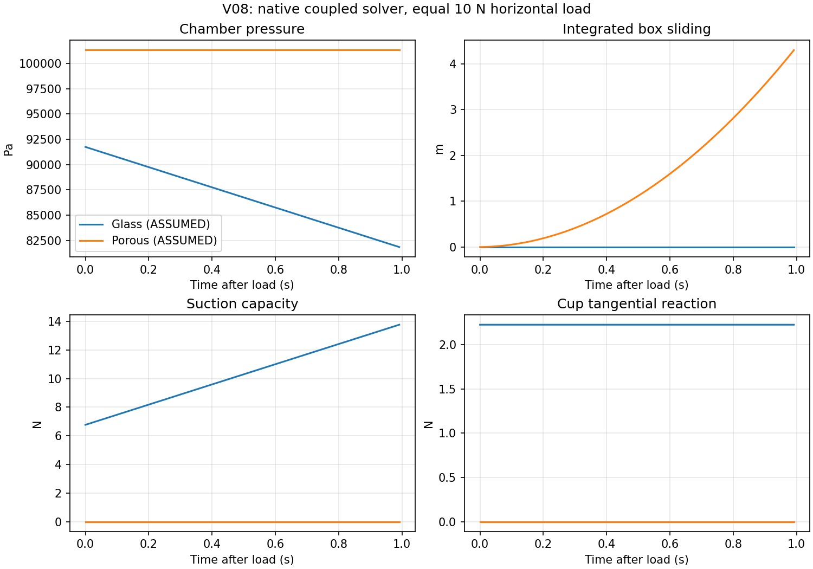
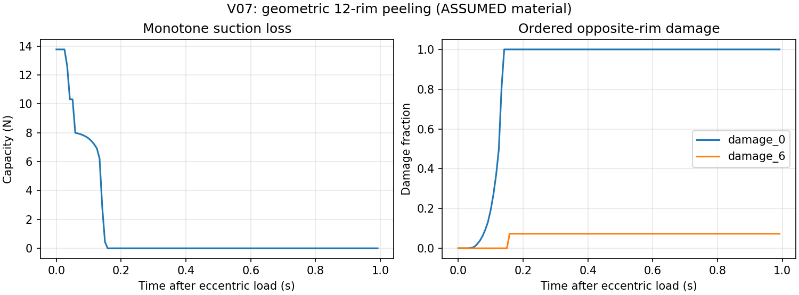

> 2026-11-14 추가 필수 계약으로 대체됨. 이 문서의 완료는 당시 강체 몸통 기준
> V06–V12 검사 기록이다. 전체 P2는 진행 중이며 P1V/P2V와 V16–V21 통과가 필요하다.
> VOLUMETRIC_SOFTBODY_ADDENDUM.md와 P2V_GAP_ANALYSIS.md를 따른다.

# P2 native completion and acceptance evidence

2026-11-14. **P2 네이티브 기능 구현과 지정 V06–V12 수용 검증 완료.**
P2.7은 전체 규모 측정과 목표 격차 기록을 완료했으며 V13 합격은 아니다.
P0/P1의 실시간 Godot 연결·출처 검증·Git 차단이 남아 있어 전체 프로젝트 단계의
통합 수용은 열려 있다. 기존 P0와 시각 시제품은 보존했다. BIO는 미검증이다.

## Final observed results

Release **33/33**, Debug **25/25**, AddressSanitizer **25/25** passed.
clang-format, clang-tidy (all native source files) and installed Godot 4.6.2
headless import/bootstrap passed. No analyzer checks or physics criteria were disabled.
Real-input replay ran 1,200 ticks. Two separate ten-second restored continuations
(rod and coupled contact/cup caches) produced identical hashes. The file-loaded
eight-arm/128-cup scene also recorded and replayed 120 ticks successfully.

| Final Release moving fixture | Observed |
|---|---|
| Simulated duration | 60 s / 7,200 ticks |
| Arms / installed cups | 8 / 128 |
| Minimum attached during periodic release | 120 |
| Maximum motion | 0.00190753 m |
| Maximum penetration | 1.99525e-08 m (<0.002 m) |
| Pressure/force consistency error | 2.21889e-09 (<0.01) |
| Step p50 / p95 | 47.6873 / 57.0959 ms |
| State chatter / release | <5 per cup in each 1 s window; no residual adhesion |

Five-second light-box relative linear/angular momentum errors: 1.56e-7/7.58e-7;
heavy box: 3.32e-7/2.42e-7 (criterion <.01). Door anchor error 2.79e-7 m,
angle .01509 rad. Independent Hessian derivative error 1.09e-10. Terminal speed
.790268 m/s matches the analytic reference at reported precision. CCD exercises
120 m/s sphere/capsule contact against thin triangles and OBBs.

Evidence: [overall transcript](P2-final-verification.log),
[Release](physics/P2-release-tests.log), [Debug](physics/P2-dev-tests.log),
[ASan](physics/P2-asan-tests.log), [binary hashes and structured summary](physics/P2-acceptance-summary.json).

## Implementation and verification map

| Task | Implementation | Acceptance evidence |
|---|---|---|
| P2.1 | Rebuilt AABB BVH, triangle BVH, sphere/OBB and deformed-radius capsules, conservative swept contact | P2.ccd (120 m/s sphere/capsule vs triangle and OBB, no tunnel); P2.capsules (reciprocal contact); physics.contact (feature IDs/BVH) |
| P2.2 | Geometry queried at twelve rim points; pressure, seal, local damage, ordered peeling, release | physics.V06/V07, P2.V06_geometry/V07/V08; V07-peel.csv and V08-*.csv plus plots |
| P2.3 | Same-objective augmented-Lagrangian normal/tangent constraints, Coulomb projection, suction preload and pressure/load outer iteration | P2.V08 Coulomb cones, penetration <2 mm and force consistency <1%; P2.hessian independent AD derivative |
| P2.4 | Shared 6-DOF bodies, eight roots, moving boxes and hinge joints | physics.V09_pair/V09_rod (5 s, light/heavy, linear/angular momentum <1%); P2.door |
| P2.5 | Capsule self-contact, fluid drag/buoyancy and hydrostatic cup pressure | P2.V10 moving 60 s/7200 ticks; P2.capsules; physics.V11 terminal speed within 10% |
| P2.6 | Runtime scene/profile loading, versioned inputs, exact build/profile matching and periodic hashes; complete cached-state save | P2.V12_io: 1200-tick real-input replay; 10 s restored rod continuation and 10 s restored contact/cup continuation; P2.schemas |
| P2.7 | Representative full-count CPU workload and measured target gap | V13-full-workload.json; V13-curved-workload.json; V13 remains NOT ACCEPTED |

## Exact commands

From D:/바탕화면/Octopus_Simulator in PowerShell:

```powershell
./tools/verify.ps1
```

This builds dev, release and ASan. Release runs all long tests; dev/ASan run
all unlabelled analytic/contact/rollback regressions. It also checks C++
formatting, static analysis, core/engine boundary and Godot headless import.
Strict `-RequireCompleteP0` remains blocked by provenance/bridge gates.

```powershell
. ./tools/dev-shell.ps1
cmake --preset release
cmake --build --preset release
ctest --preset release --output-on-failure
build/release/octo_replay.exe --scene tests/scenes/P2_eight_cups.json --validate-scene
build/release/octo_replay.exe --scene tests/scenes/V12_runtime.json --inputs tests/scenes/V12_inputs.json --record work/replay.json --ticks 1200 --checkpoint work/final.octostate
build/release/octo_replay.exe --scene tests/scenes/V12_runtime.json --replay work/replay.json
build/release/octo_benchmark.exe
build/release/octo_benchmark.exe --curved
python tools/plot_p2_results.py
```

The two benchmark variants are measurements, not V13 acceptance tests. The
curved variant currently exposes a known convergence failure
and exits 2; failure rollback/checkpoint is preserved, not skipped.

## Performance environment and interpretation

Windows x64 (10.0.26200), AMD Ryzen 5 5600X six cores/12 threads; MSVC
19.43.34809, CMake 3.31.7, Ninja 1.12.1, C++20 /O2 /fp:precise, native CPU
solver. Hardware observations are in BOOTSTRAP.md; RAM amount not established.
This is not the target eight-core hardware. Renderer FPS/GPU timing are not
measured by a native headless benchmark.
Full-count fixture: eight 24-element arms, 128 cups, 20 boxes, 100,000 static
triangles. A flat floor completed ten ticks and retained all 128 cups; many
coplanar triangle constraints produce >2,300 contacts rather than the target
300. p50/p95 are short-run sorted floor(n*p) order statistics (zero-based, upper median for even n), not steady-state claims.
Final full-count flat floor: p50 607.062 ms, p95 1474.559 ms, 2366 maximum ordinary contacts, all 128 cups retained.
Contact manifold reduction and solver optimization belong to the next
performance work; no 8.33 ms or ten-minute V13 acceptance is claimed.
Curved-floor overload fails its outer multiplier consistency at tick 1 despite
small position/pressure residuals. Do not infer general terrain robustness
from flat-floor acceptance. Both inputs and failure checkpoints are retained
under work/ and the measured JSON remains in docs/progress/physics/.

## Model limits and remaining gates

All mechanics/cup/friction coefficients are ASSUMED, not measured octopus
tissue. Radius-volume law is a rod approximation, not full 3D incompressibility.
Dynamic convex support is sphere/OBB; arbitrary convex meshes and continuously
rotating OBB/OBB are unsupported. P1 still lacks nondimensional residual
scaling and general asymmetric root mass/COM reduction. See PHYSICS_MODEL.md.

P0 tool/dependency archive verification, protected Git writes, remote access,
real hosted CI, and the live compiled Godot bridge remain unresolved.
physics_lab is labelled OFFLINE PLAYBACK; run_preview.cmd remains a visual
prototype. Neither is represented as completed real-time game physics.
No P3/P4, human playtest, BIO or completed-game release has been approved.

Branch feature/P0-bootstrap; existing HEAD
4541a5975d62143c3cbf51a2c7a8cdd3adb81aac. New implementation is in the working
tree; Git metadata writes are protected, so no new commit/tag/push is claimed.

## Evidence plots and next work





V08 uses equal 10 N horizontal load for one second. Current native CSV gives
glass x approximately -1.73e-12 m, porous x approximately 4.30 m; glass suction
capacity 13.77 N, porous 0. These are test fixture results, not material
measurements or production gameplay parameters. V07 records ordered rim
damage and monotone loss to zero capacity around 0.16 s after eccentric load.

Next in document order: resolve upstream engine integration/provenance, then
P3 command planner and live controls/visual mesh. Performance priority is
merging coplanar triangle contacts, profiling contact Jacobian/Hessian blocks,
and robust curved-surface multiplier convergence. Engine switch or product
scope reduction requires its existing approval gate. Human controls/playtest
and BIO approval remain separate and have not been inferred automatically.

Final core build fingerprint: `a860f4ea1b6e4d58c546fd240565ca7c6d1e0b62ddf205531bd3be77eb9d134b`.
Git write failure: [P2-git-write.log](P2-git-write.log).
